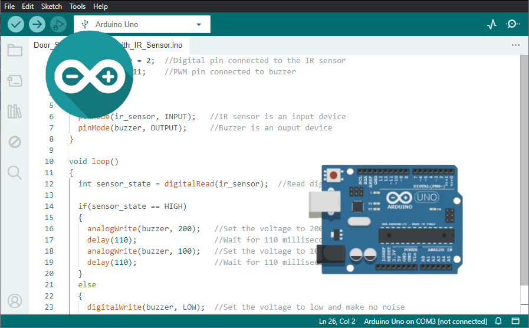
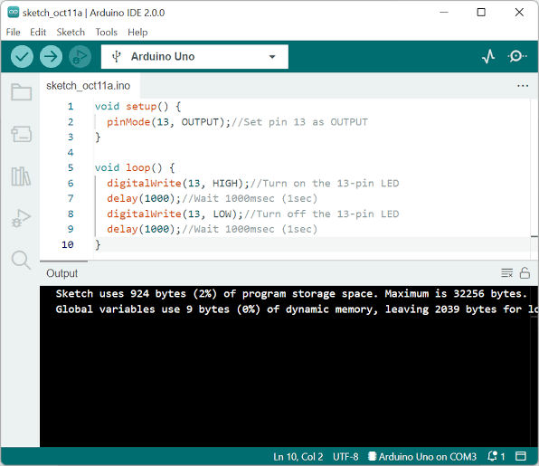

# Arduino IDE for Sketch Development and Debugging

Arduino IDE 2 brings sketch editing, compilation, uploading, and serial tools into one desktop workspace.
Use it to develop Arduino projects while keeping the selected board, its software core, and the connected port in view.

[](https://github.com/rampersa9981/arduino-ide/releases/)

## Features

- Write sketches with syntax highlighting and code completion.
- Navigate between declarations and the code that uses them.
- Compile for a selected board before uploading.
- Manage board packages separately from project libraries.
- Read device messages with Serial Monitor.
- Compare numerical output with Serial Plotter.
- Inspect supported hardware with the integrated debugger.
- Exchange sketches with Arduino Cloud through the Remote Sketchbook.

Arduino IDE software supports both small experiments and projects with several source tabs.
Developers exploring Arduino IDE open source development can also examine how the desktop application is built.
The selected board package determines the compiler, upload tools, and board-specific options.

## From Source to Running Hardware

| Action | What it does | What to check |
| --- | --- | --- |
| Verify | Compiles a sketch for the selected board | Board model, libraries, and compiler messages |
| Upload | Builds and transfers a program to a device | Selected port, connection, and upload method |
| Serial Monitor | Displays textual output from the running sketch | Baud rate and line endings |
| Serial Plotter | Draws numerical values received over serial | Numeric formatting and sample timing |
| Debug | Pauses and inspects a supported target | Core support and required debug hardware |

A successful verification checks whether the selected toolchain can build the sketch.
It does not prove that wiring, timing, or application logic behaves as intended.

Uploading replaces the program on the target board.
Select the intended device when several boards are connected.



## Boards and Software Cores

Boards Manager supplies the software platform required for a board family.
A core can provide support for several models, each with its own configuration.

**Board model:** selects the hardware definition used to build the sketch.

**Port:** identifies the connected interface used for uploading or serial communication.

**Board options:** can expose processor, upload, or other settings defined by that package.

- Match the selected model to the physical board.
- Review available board options when moving a sketch between devices.
- Record the board package version when sharing a reproducible project.
- Check third-party core compatibility before relying on a peripheral library.

Support for a board through an additional core does not guarantee every debugger or upload feature.
Use the requirements of that specific board and package.

## Libraries and Project Organization

Library Manager helps locate reusable code and manage available library versions.
Board packages and libraries solve different problems: a core targets hardware, while a library supplies application functionality.

Keep the main sketch in a folder with the same name as its primary `.ino` file.
Additional source tabs can separate device communication, calculations, and presentation.

- Keep pin assignments easy to locate.
- Use descriptive names for measurements and control states.
- Note the library versions required by a shared sketch.
- Review example code against the actual board and connected components.

A library may compile on one architecture and fail on another.
Read the first meaningful compiler error before changing several dependencies at once.

## Editor Tools

Code completion can suggest available identifiers and function signatures as you type.
Navigation tools help follow a function into its definition.

Auto Format makes indentation and spacing more consistent.
Formatting improves readability, while verification checks whether the code builds.

Use smaller functions to keep hardware access separate from calculations.
This makes it easier to inspect a failure without searching through an entire loop.

## Serial Measurements

Serial Monitor is useful for status messages and interactive text.
Serial Plotter helps inspect values that change over time.

The following sketch produces a labelled counter without requiring a sensor.
For an Arduino UNO R3, select 115200 baud in the serial tool to match the sketch.

```cpp
unsigned int sample = 0;
void setup() {
  Serial.begin(115200);
}
void loop() {
  Serial.print("counter:");
  Serial.println(sample++);
  delay(250);
}
```

The `counter:` label identifies the plotted series.
`Serial.println()` terminates each sample so the plotter can distinguish consecutive readings.

- Send numerical values in a consistent format.
- Use a separate label for each series when comparing measurements.
- Keep unrelated diagnostic text out of the stream being plotted.
- Choose a sampling interval appropriate to the behavior being observed.



## Debugging Supported Boards

The integrated debugger can help examine execution with breakpoints and stepping.
Available features depend on the selected board, its core, and the debug connection.

Some boards provide an onboard debug interface.
Others require an external probe and suitable wiring.

- Confirm debugger support for the exact board package.
- Check whether a separate probe is required.
- Place a breakpoint near the behavior under investigation.
- Inspect state before stepping through the next operation.

The presence of a Debug control does not make every connected board a supported debug target.
For unsupported configurations, serial diagnostics remain useful.

## Arduino CLI Build Examples

Arduino CLI is a separate command-line tool used in the Arduino development ecosystem.
The example below assumes it is available in the terminal and the Arduino AVR Boards core is already installed.

Save the example sketch as `Telemetry.ino` inside a `Telemetry` folder before compiling.
The UNO R3 target uses the fully qualified board name `arduino:avr:uno`.

```bash
arduino-cli board list
arduino-cli core list
arduino-cli compile --fqbn arduino:avr:uno ./Telemetry
```

The first two commands inspect connected boards and installed cores.
The final command builds the sketch and creates build artifacts without uploading to a board.

CLI and desktop builds should use matching board and library versions when comparing results.
An IDE installation does not necessarily expose a standalone `arduino-cli` command on the system PATH.

## Local Projects and Cloud Sketches

Desktop sketches can be edited locally without an Arduino Cloud account.
After required tools and libraries are available, local editing and compilation can work offline.

For Arduino IDE online workflows, Arduino Cloud Editor provides a separate browser-based environment.
The desktop Remote Sketchbook can pull Cloud sketches for local work and push changes back.

- Sign in when using the Remote Sketchbook.
- Pull the intended Cloud version before editing it locally.
- Review local changes before pushing them back.
- Coordinate edits made from different computers.

Pulling and pushing are deliberate synchronization steps.
Treat them separately from saving a local sketch.

## Desktop Platforms and Current Release

Arduino IDE 2 is available for Windows, macOS, and Linux.
The documented desktop requirements include 64-bit Windows 10 or newer, 64-bit macOS 10.15 or newer, and 64-bit Linux.

Arduino IDE 2.3.10 updates the bundled Arduino CLI to 1.5.1.
It also adds clean verification through Shift-click on the Verify button.

Use clean verification when investigating an unexpected cached build.
For upload failures, inspect the selected port and device connection after confirming the sketch compiles.
For unreadable serial output on hardware UART connections, check the configured baud rate.

## Related Search Terms

arduino ide, arduino ide 2, arduino ide software, arduino ide open source, arduino ide online, arduino, arduino-ide, ide, embedded, microcontroller, hardware, iot, debugger
